# Cockpit for Claude Code

**English** · [Français](README.fr.md)

An animated side panel for [Claude Code](https://claude.com/claude-code) that keeps two things in sight while Claude works: **what the session is consuming**, and **where the plan stands**.

<p align="center">
  
</p>

<sub>Animated mockup of the panel, drawn from the mod's layout. In the terminal, the panel is made of character cells and follows your terminal's color theme.</sub>

## What it shows

**Configuration**

- **Model and effort**: `Opus 5.5`, `high / max`, read from every request.
- **Execution mode**: `default`, `accept edits`, `plan`, `auto`, `bypass`. It changes as soon as you press `shift+tab`.

**Statistics**

- **The session**: its duration, its cost at API prices and its tokens, subagents included: sent (↑), received (↓) and the request count.

**Activity, always on**

- **5-hour window**: how much is used, when it renews, and **where it is heading at the current pace**. For example, `⚑ at the current pace: 100 % before the end, around 14:32`.
- **Week**: how much is used and when it renews.
- **Context**: tokens out of the window, split into system, tools, messages and the compaction reserve. A toast warns you when the context reaches 90 % of the auto-compaction threshold.
- **Flow**: output tokens per request, and the size of the latest answer.
- **Cache**: every request sends the whole conversation again; what the API has already seen it reads back from its prompt cache, about ten times cheaper. The cockpit shows the share of what was sent that came from the cache.
- **In the background**: shells and subagents still running, each with its run time.

**The plan, as a timeline**

- Claude declares the plan with an estimate for each step, then reports every transition. The cockpit draws a timeline across the whole width: a node where each step began and a ⚑ where the plan ends, each step as long as it lasts. Above the nodes, the step numbers; below them, the times: real for the steps already started, expected (`~14:56`) for the others, and the expected finish under the ⚑. Under the timeline, each step's time against its estimate, a bar for the running step (it turns red past its estimate), and the elapsed and remaining time on the line under the plan's title.
- **Calibration across sessions**: the cockpit stores the real time against the estimate for every measured step. After five steps, it gives the ratio back to Claude, who adjusts its next estimates. The panel does not show it.
- **Alerts**: a blocked step (Claude waiting for you) and a finished plan each send a terminal notification and a toast.
- Ten minutes after a plan finishes, the panel shows the plans this session finished instead.

**Foldable sections**

- In the side panel, every section title folds and opens again: click it, or press its key once the panel has the keyboard (`ctrl+x tab`): `1` Configuration, `2` Statistics, `3` Activity, `4` Plan.
- A folded section keeps a one-line summary. For the configuration: `◆ Opus 5.5 · auto · effort high`. For the activity, the 5-hour window: how full it is, when it ends and where the current pace takes it, in the gauge's colors (`5 H 57 % · fin 15:10 (1 h 12)  ⚑ 100 % vers 14:32`).
- The choice is kept from one session to the next.

**Two layouts, chosen by Claude Code**

In the fullscreen layout, from 110 columns, the cockpit docks to the right of the transcript. In a narrower terminal, it becomes a band above the prompt:

<p align="center">
  
</p>

> The panel's labels are in French (`SEMAINE`, `CONTEXTE`, `EN FOND`…). An English version is on the roadmap.

## Install

Requires **Claude Code 2.1.275 or later**: earlier versions cannot install a plugin from its marketplace in one step. The cockpit was developed and tested on 2.1.296.

In a Claude Code session, type:

```text
/plugin install cockpit --marketplace Happykiller/claude-cockpit
```

Answer `y` to add the marketplace, then pick a scope. **User** makes the cockpit available in every project. The cockpit is active right away and opens on its own at the start of each session.

### Recommended setup

**1. Let Claude update the plan without asking.** The cockpit registers two tools, `mcp__cockpit__plan` and `mcp__cockpit__step`. In the default permission mode, Claude Code may ask for approval at every step. To allow them once and for all, add them to `~/.claude/settings.json`:

```json
{
  "permissions": {
    "allow": ["mcp__cockpit__plan", "mcp__cockpit__step"]
  }
}
```

Merge this with your existing `allow` list rather than replacing it.

**2. Remove the gray tint behind the side panel (optional).** Claude Code paints the docked panel with its own gray (`composerSidebarBackground`), which no plugin can change. The plugin ships a theme that keeps your terminal's background behind the cockpit and is otherwise identical to the dark theme. Pick **"Dark — untinted side panel"** in `/theme`.

If that theme is not listed in `/theme`, install it as a user theme:

```bash
mkdir -p ~/.claude/themes
curl -fsSL https://raw.githubusercontent.com/Happykiller/claude-cockpit/master/themes/cockpit-dark.json \
  -o ~/.claude/themes/cockpit-dark.json
```

Then set `"theme": "custom:cockpit-dark"` in `~/.claude/settings.json`, or pick it in `/theme`.

**3. Give it room.** The docked layout needs Claude Code's fullscreen layout and at least 110 columns. Below that, you get the band.

## Use

Nothing to do: a section of the system prompt asks Claude to declare a plan for any task of three steps or more, and to report each step as it goes. You can also ask for it: *"put the plan in the cockpit"*.

| Command | Effect |
| --- | --- |
| `/cockpit` | Opens the panel again (after you closed it) |
| `/cockpit reset` | Clears the current plan |
| `/cockpit close` | Closes the panel |

The cockpit also follows `TodoWrite` and `TaskCreate` / `TaskUpdate` lists when a session uses them.

To update, disable or uninstall the plugin, use the `/plugin` menu.

## How it works

The cockpit is a Claude Code **mod**: a hooks module (`hooks/register.tsx`) that the engine loads with the plugin. It only reads what the engine exposes to plugins:

| Shown | Source |
| --- | --- |
| Model, effort, context and tokens per request (subagents included for the tokens) | the `turn.step` stream |
| Limits, renewal times, cost, context split | `session.measure` and `$.session.usage()` |
| Execution mode | the `permission_mode` of hook inputs and the prompt footer's hint |
| Background work | `classic.Stop` (`background_tasks`), `SubagentStart` / `SubagentStop`, background `Bash` calls, task-end notifications (`prompt.submit`), `$.agent.list()` |
| The plan | its own tools `mcp__cockpit__plan` / `mcp__cockpit__step`, plus `TodoWrite` and the task tools |

The calibration samples (the last 60 measured steps) the latest finished plans (the last 40, all sessions together, each tagged with its session) and the panel sections you folded are kept in the plugin's local store, under your Claude Code configuration directory. **Nothing is sent anywhere.**

## Develop

```bash
git clone https://github.com/Happykiller/claude-cockpit.git
claude --plugin-dir ./claude-cockpit
```

For hot reloading while you edit, point `CLAUDE_CODE_PLUGIN_DIRS` at the folder, for example in the `env` block of `~/.claude/settings.json`. An interactive session then reloads the mod each time you save.

After the engine has loaded the mod once, it writes its type definitions into `.claude-plugin/types/`. They are git-ignored, and `tsconfig.json` extends them.

```bash
npx -y -p typescript@5.6.3 tsc -p .   # type-check
claude plugin validate .               # manifest, marketplace, hooks
claude plugin test .                   # tests/*.test.ts
python3 docs/make_demo.py              # regenerate the README mockups
```

| Path | Role |
| --- | --- |
| `hooks/register.tsx` | the hooks: events, tools, the `/cockpit` command, state |
| `hooks/model.ts` | pure logic: formatting, plan transitions, totals, projection, calibration |
| `hooks/view.tsx` | the drawing: the docked panel and the band |
| `types/index.d.ts` | the state contract (`PluginState`) |
| `themes/cockpit-dark.json` | the untinted side-panel theme |
| `docs/make_demo.py` | the animated SVG mockups |

## Limits

- The panel's labels are in French.
- The background list is complete at the end of each turn. Between two turns, it adds what starts, drops a task as soon as its end notification arrives, and checks the subagents against the engine's list every 15 seconds.
- The session's token tally starts when the mod loads: a session already running when it was installed or reloaded does not count what came before.
- Calibration starts after five measured steps. A step only counts as measured if Claude opened it before closing it.
- No sound: the engine has no audio player on Linux or Windows terminals.

## License

[MIT](LICENSE)
